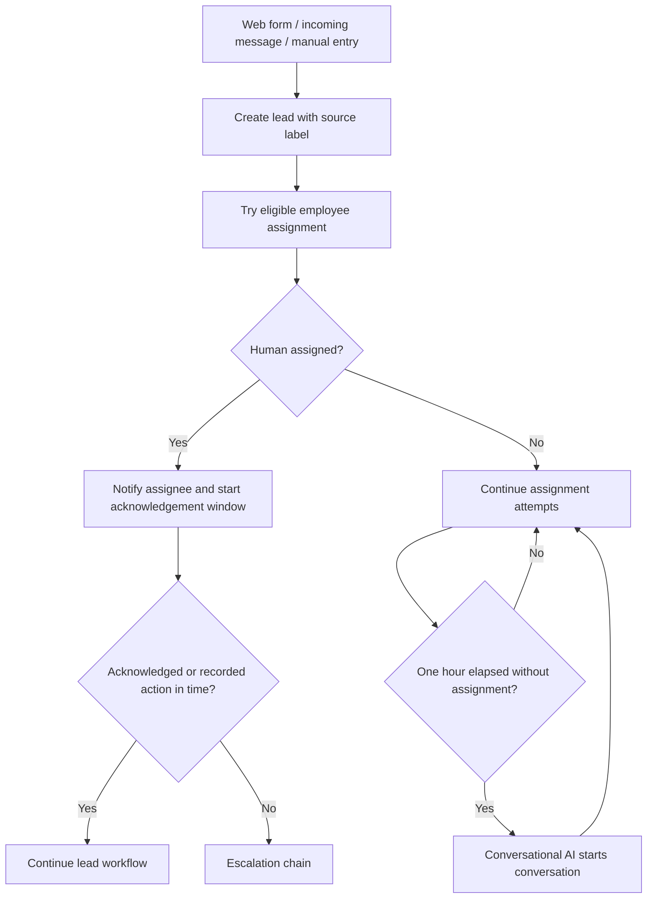
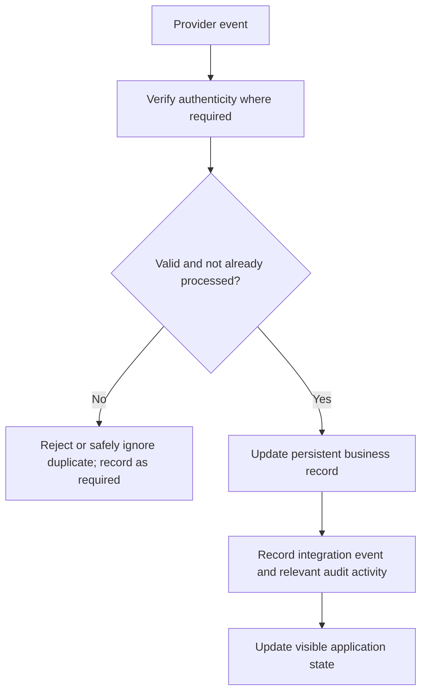

# System Architecture
**Status: BLOCKED / NOT DESIGNED.** The project's requirements-engineering approval gate says architecture design must not proceed until the requirements and MVP scope are explicitly approved. This file is therefore a controlled placeholder and boundary inventory, not an approved architecture.

**Related:** [PRD](PRD.md) · [TRD](TRD.md) · [Database](database.md) · [App Flow](appFlow.md)

## 1. What is confirmed
- The product is a web platform for multiple isolated company workspaces.
- It must include accounts/permissions, customizable CRM, lead assignment/escalation/recovery, audit history, operational dashboard, and real external integrations.
- The system must separate business rules, data access, integrations and presentation (Q14).
- A real database, durable timers across restarts, server-side authorization, idempotent webhook processing and live updates are required.
- Twilio messaging, Stripe test payments and Google Calendar OAuth 2.0 are required; I4 notification category is transactional email, provider unresolved.

## 2. Architecture decisions deliberately withheld
No framework, language, database engine, hosting service, monolith/service topology, queue, real-time protocol, scheduler, API style, folder structure, authentication vendor, or deployment diagram is approved. Selecting these now would violate the project's requirements approval gate.

## 3. Confirmed responsibility boundaries (not a component design)
The following are requirement domains, not a decision to implement separate services:
- Identity, workspace and permissions (F1).
- CRM and pipeline configuration (F2).
- Lead intake, assignment, acknowledgement, escalation and recovery (F3).
- Audit history (F4).
- Operational dashboard (F5).
- Messaging, payments, calendar and notification provider interactions (I1–I5).
- Presentation, business rules, data access and external integration concerns must remain separable (Q14).

## 4. Requirement-level event paths
These diagrams show business behavior only; they do not prescribe deployment components.

### Lead intake and assignment

**Important unresolved behavior:** how this path interacts with the conversation-summary email and chatbot takeover on email non-response is not established. See PRD OQ-01–OQ-04 and OQ-08. Diagram is a partial depiction of confirmed rules, not a complete state machine.

### External event integrity

This is a requirement-level flow only; exact implementation is unselected.

## 5. Trust boundaries and mandatory controls
- Browser/client is not trusted for authorization, secrets or validation.
- Every protected endpoint must verify workspace and permission (Q2).
- Webhook senders must be authenticated by provider signatures where specified (I1.2, I2.3).
- Provider secrets/tokens remain server-side (I5.3).
- Payment card details remain on provider-hosted page and are never stored/logged (I2.8).
- Workspace data and provider connections are isolated (F1.6, I5.2).

## 6. Failure modes required to be handled
- Provider outage/rejection: keep failed messages visible with reason and retry path; integration failures must not stop unrelated platform functionality (I1.7, I5.5, I5.8).
- Duplicate or concurrent webhooks: do not duplicate business records (I1.8, I2.4, Q5).
- Server restart during timer: assignment/escalation timing remains correct (Q5).
- Concurrent assignment/timer expiry: never assign two owners or escalate twice (F3.8).
- Revoked/expired calendar authorization: show reconnection requirement (I3.2).
- Missing calendar connection: do not allow booking for that employee and explain why (I3.7).
- Unapproved custom-field change/delete: Admin decision is not valid until Owner acknowledgement (confirmed clarification); pending-state behavior is unresolved.

## 7. Architecture approval checklist
Before replacing this placeholder with a real design:
1. Resolve blocking business questions in PRD.
2. Confirm whether multiple pipelines are in MVP.
3. Approve MVP scope and any proposed deferrals.
4. Explicitly approve the requirements baseline.
5. Only then evaluate technology and architecture options.
6. Document approved component boundaries, data flow, API contracts, deployment, persistence, timers, real-time updates, failure recovery, and folder structure.
