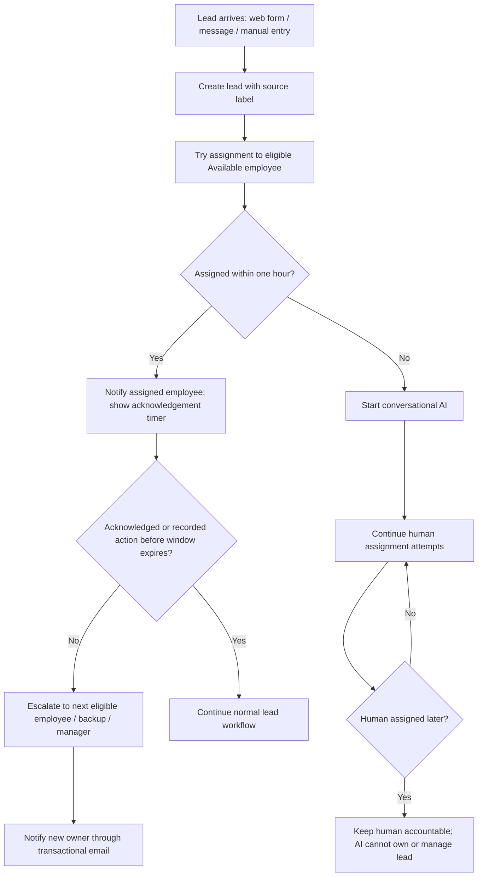

# Application and User Flow
**Status:** Draft flows derived from source requirements and confirmed clarifications. Detailed navigation and screen designs are not approved.  
**Related:** [PRD](PRD.md) · [Design](design.md) · [Architecture](Architecture.md)

## 1. Screen inventory (requirement-derived, not final navigation)
| Screen / view | Purpose | Source |
|---|---|---|
| Sign up / login / logout | Create workspace, authenticate and end session | F1.1 |
| Workspace/user/permissions settings | Invite users, assign base levels and configure permissions | F1.2–F1.3 |
| CRM contact detail | Show related company/opportunities, conversations, payments, appointments, assigned employee and history | F2.1, F2.8 |
| CRM opportunity detail/list/board | Manage opportunity, stage, values subject to permissions, and related activity | F1.4, F2.5, F2.7 |
| Custom fields / pipeline settings | Create fields and configure pipeline stages/required fields | F2.2–F2.5 |
| Saved lists | Filter by supported criteria and save dynamic result sets | F2.6 |
| Lead intake form | Accept external lead submissions and create source-labelled leads | F3.1 |
| Lead workspace / conversation | View assignment, acknowledgement timer, messages, action history | F3.4, F2.8, I1 |
| Employee availability | Set/view Available, Busy, On leave, Offline | F3.2 |
| Recovery queue | Show overdue, repeatedly escalated or idle leads and reason | F3.7 |
| Operational dashboard | Show live operational figures and permitted drill-downs | F5.1–F5.5 |
| Audit history | Filter immutable action history by event type/user/date | F4.1–F4.3 |
| Integrations page | Show connection state, last success, errors and synchronization history | I5.1, I5.4 |
| Payment request/status | Create hosted checkout/payment link and show status | I2 |
| Calendar booking/connection | Connect account, book/reschedule/cancel appointment, show busy times/status | I3 |
| Custom-field approval | Owner acknowledges Admin's proposed change/deletion | Confirmed clarification; exact UX unresolved |
| AI conversation | Conversational AI on web chat and messaging integration; conversation/recommendation only | Confirmed clarification |

## 2. Authentication and workspace creation
1. User opens sign-up.
2. User submits required sign-up information. Exact field list and validation constraints are unresolved.
3. On success, system creates a workspace and makes the first user its Owner (F1.1).
4. Session persists across refresh and can be ended through logout (F1.1, Q1).
5. On failure, show a clear error and actionable next step (Q10); exact error catalogue is not specified.
6. Every subsequent request is checked against the user's workspace and permissions server-side (F1.5–F1.6, Q2).

## 3. Lead intake, assignment and AI conversation

- Employees who are Busy, On leave or Offline do not receive new leads.
- Assignment uses configurable round-robin and open-lead limit.
- AI channels: web chat and messaging integration.
- AI can converse and recommend only. It cannot independently take ownership or perform lead-management actions.
- Human assignment attempts continue after AI starts.
- One accountable human owner at a time is required.
- The conversation-summary email and “if no response, chatbot handles the conversation and the earlier assignee remains responsible” rule are not yet integrated into this flow. OQ-01–OQ-04 and OQ-08 block finalization.

## 4. Acknowledgement, escalation and recovery
1. Assigned employee receives an in-app notification; remaining time is visible.
2. Employee acknowledges or performs a recorded action (note, message, call log, stage change, appointment).
3. If the configurable window expires, system escalates through configured levels: next eligible employee, designated backup, then manager.
4. Manual reassignment is recorded separately from automatic escalation.
5. Recovery queue includes leads unacknowledged beyond their window, escalated at least twice, or untouched for configured idle period, and displays the reason.
6. If an employee is set Offline or On leave, their unacknowledged and acknowledged leads are reassigned to a free employee in the same department (confirmed clarification). Behavior when no such employee is available remains unresolved.

## 5. CRM and pipeline configuration
### Custom fields
1. Admin opens field configuration and chooses name/type from text, number, date, dropdown, checkbox.
2. Field appears on relevant forms/details.
3. Admin's proposed field change/deletion is not valid until acknowledged by the Owner of the tenant that registered with the platform.
4. Pending request UI, notification, rejection and timeout behavior are unresolved.

### Pipeline stage deletion
1. Admin requests deletion of a stage.
2. System checks whether opportunities remain in the stage.
3. Under confirmed clarification, Admin must move all opportunities to another stage before deletion.
4. If opportunities remain, block deletion and explain what must be done.
5. Once empty, deletion may proceed subject to permissions and source data-integrity rules. Any additional deletion confirmation UX is not specified.

### Stage transition
1. User attempts to move an opportunity.
2. System checks configured required fields for destination stage.
3. If required values are missing, block the move and explain which fields are needed.
4. Otherwise update stage and record activity history.

## 6. Messaging
- Incoming real provider message reaches a verified webhook and appears in conversation view.
- Known messaging phone number attaches to its existing contact; unknown number creates contact and lead.
- Duplicate provider delivery must not create duplicate messages/leads.
- Employee sends reply from platform; status callbacks update sent/delivered/failed state.
- If send fails, retain the failed message and reason and allow retry.
- Opted-out contacts cannot be messaged; UI explains why.
- Conversation is visible only to users with permission and shows assigned employee.

## 7. Payments
1. Employee starts payment request from an opportunity and enters amount/currency.
2. Platform creates a hosted payment link/checkout session and can send it to the customer.
3. Provider webhook is verified before changing records.
4. Status updates without manual refresh and handles paid, expired, abandoned, failed and refunded outcomes.
5. Dashboard collected revenue counts provider-confirmed payments minus confirmed refunds; unpaid requests remain projected revenue.
6. Card details are entered on provider-hosted page; platform never stores or logs card numbers.

## 8. Calendar
1. Employee connects their Google account through OAuth consent and may disconnect it.
2. Booking UI reads busy times and prevents or warns about overlap.
3. Booking creates a real Google Calendar event and a platform appointment linked to contact/opportunity.
4. Reschedule/cancel updates the Google event and records activity.
5. Expired/revoked connection is shown as needing reconnection; employee without connected calendar cannot be booked and sees why.
6. Displayed times respect timezone; stored values are unambiguous.

## 9. Dashboard and audit
- Dashboard shows source-required figures and uses glossary definitions.
- At least three figures drill down to permitted filtered lists.
- User sees personal figures; Owner/Admin see company-wide figures.
- User can show/hide figures and the preference persists.
- Audit screen is available only with audit permission; filters include event type, user and date.
- Audit records cannot be edited or deleted.

## 10. General interaction states
Source Q10 requires loading, success and failure feedback for every action. Forms require server-side validation; error messages should explain what went wrong and what the user can do. Empty, disabled, retry, permission-denied and provider-disconnected states must be documented as the affected workflows are finalized. Exact wording and screen navigation remain to be designed.
