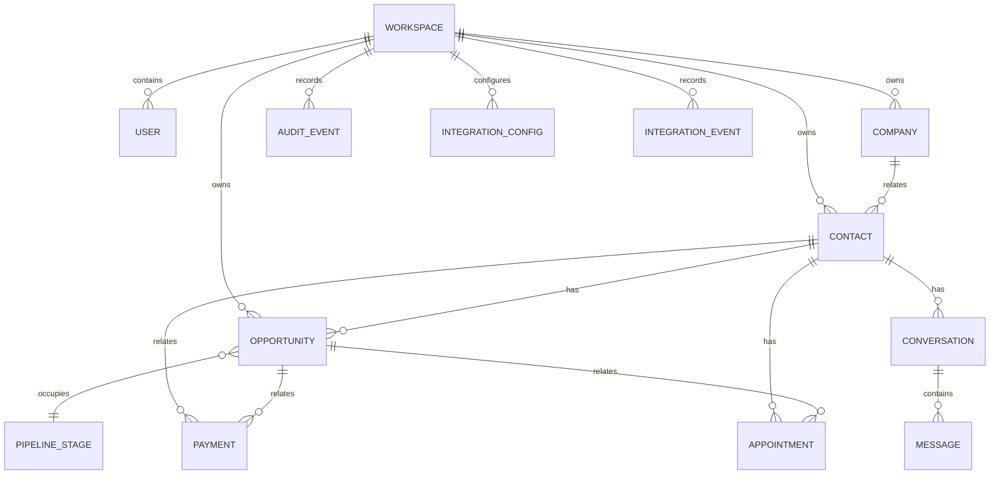

# Database Design
**Status:** Logical data inventory only. No physical schema, database engine, column types, indexes or migrations are approved.  
**Related:** [PRD](PRD.md) · [TRD](TRD.md) · [Architecture](Architecture.md)

## 1. Governing rules
- Q6 requires a real persistent database; data must survive restart.
- Workspace configuration is stored per workspace.
- Every record access must enforce workspace isolation and permissions (F1.6, Q2).
- Q4 requires related records to remain consistent and concurrent edits not to silently overwrite each other.
- Do not treat the logical inventory below as a finalized schema. Fields beyond explicitly named concepts require approval/design after the requirements baseline is approved.

## 2. Source-supported logical entities
The source directly names or requires the following data concepts. Names are logical labels, not final table names.

| Logical entity | Why it exists | Explicit relationships / data concepts |
|---|---|---|
| Workspace / company tenant | Isolated company environment | Own users, data, configuration and integrations. |
| User / employee | Human account and lead handler | Base levels Owner/Admin/User; configurable permissions; availability status; department is referenced by a stakeholder clarification. |
| Role / permission | Controls access | Base levels plus configurable permissions for view/create/edit/delete/export CRM records, assignment rules, integrations and audit log. |
| Contact | Customer record | Belongs to a company; may have multiple opportunities; messaging phone number used for known-number matching. |
| Company | CRM organization associated with contacts | Contact/company relationship required by F2.1. |
| Opportunity | Sales pipeline record | Related to contact/company; stage and value; payment request/status; stage-specific required fields. |
| Pipeline / stage | Configurable sales process | Admin can add/rename/reorder/delete stages; won/lost state affects open pipeline value. Multiple-pipeline ambiguity remains open. |
| Custom field / field value | Tenant-configurable CRM fields | Types: text, number, date, dropdown, checkbox; pipeline-specific field sets; stage-required fields; change/delete requires tenant Owner acknowledgement. |
| Lead | Intake and assignment record | Source label; assigned time; acknowledgement; owner; escalation/recovery state; created from form, message or manual entry. |
| Conversation / message | Customer communication history | One contact, one channel; assigned employee; optional opportunity; provider message/status; opt-out affects messaging. |
| Payment / payment request | Payment traceability | Opportunity, contact, requesting employee, provider reference, amount/currency and status are source-supported concepts. No card details stored. |
| Appointment | Calendar event | Linked to contact or opportunity; employee calendar; time zone; event changes/cancellation. |
| Audit event | Immutable record of important actions | Actor/system, time, target and before/after values where relevant. |
| Integration configuration / connection | Workspace-specific provider connection | Status, last working time, errors; per-workspace credentials/connection; secrets protected. |
| Integration event / synchronization record | Trace inbound webhooks and outbound calls | Time, result and reference; authorized review. |
| Saved list | Saved dynamic filter | Criteria from field, tag, stage, owner and date; automatically reflects matching changes. |
| Dashboard preference | Remember show/hide choices | User's figure visibility preference. |
| AI conversation context / summary | Support the confirmed conversation and summary-email behavior | Summary of whole conversation context; detailed storage/retention fields unresolved. |

## 3. Relationship sketch

**Important:** This is a conceptual sketch only. It shows source-supported concepts but does not settle cardinality where the source is silent, and is not an approved physical ERD. Relationship corrections may be needed during requirements validation.

## 4. Explicit data and integrity rules
- Every tenant-owned record must be isolated by workspace; guessed IDs cannot cross workspace boundaries.
- Opportunity value is hidden/masked for users lacking permission in lists, details and exports.
- Contacts and opportunities expose their related records and activity history.
- Audit history includes actor/system, timestamp, target and before/after values where relevant; entries are immutable through the application.
- Known messaging phone number attaches incoming message to existing contact; unknown number creates contact and lead.
- Duplicate messaging webhooks must not create duplicate messages or leads; duplicate payment events must record payment once.
- No card number may be stored or logged.
- Confirmed payments minus confirmed refunds define collected revenue.
- Open pipeline value excludes won/lost stages.
- Before a stage is deleted, all opportunities in that stage must be moved elsewhere.
- Admin custom-field change/delete requires acknowledgement from the registered tenant Owner.
- Per-workspace integration credentials and configuration are isolated; secrets are not sent to browser or committed to source.

## 5. Not specified / must not be invented yet
- Physical database engine, table/collection names and column types.
- Generated ID format, timestamps beyond source-defined concepts, soft-delete policy, cascade behavior and uniqueness constraints beyond required idempotency/phone matching behavior.
- Data retention, legal deletion, backup/restore objectives and archival rules.
- Exact representation of departments, designated backup, manager assignment, AI context, email delivery attempts and custom-field approval states.
- Currency precision and supported currency list.
- Whether a contact may belong to multiple companies, or an opportunity may reference multiple contacts.
- Multi-pipeline model, given source ambiguity.
- Schema migration/seeding technology.

## 6. Proposed design work after approval
After requirements/MVP sign-off and architecture authorization, finalize:
1. ER model and cardinalities.
2. Tenant-scoped primary/foreign keys and uniqueness rules.
3. Field types and custom-field value strategy.
4. Indexes for lead assignment, timers, recovery queue, filters, activity history and provider event idempotency.
5. Transaction/concurrency strategy for assignment and webhook processing.
6. Retention, deletion, backup and migration rules.
