# CRM Database Schema
> Unified Business Management Platform — Target CRM Database Design  
> Derived exclusively from Document A (Problem Statement) and Document B (EduNexus ERP DDL).  
> All tables reside in schema `crm` unless noted. Every table carries `workspace_id BIGINT NOT NULL` (TD-1.1) and `created_at / updated_at TIMESTAMPTZ` audit columns.

**Legend**  
- `[R]` Retained from ERP as-is  
- `[M]` Modified from ERP source  
- `[N]` New — no ERP equivalent  
- `[PTD]` Proposed Technical Decision — not specified in Document A

---

## Table of Contents
1. [Workspace & Auth](#1-workspace--auth)
2. [Contacts & Companies](#2-contacts--companies)
3. [Pipelines & Custom Fields](#3-pipelines--custom-fields)
4. [Opportunities](#4-opportunities)
5. [Leads, Assignment & Escalation](#5-leads-assignment--escalation)
6. [Messaging — Twilio](#6-messaging--twilio)
7. [Integrations](#7-integrations)
8. [Payments — Stripe](#8-payments--stripe)
9. [Calendar — Google](#9-calendar--google)
10. [Notifications](#10-notifications)
11. [Audit & Filters](#11-audit--filters)
12. [Modified Infrastructure Tables](#12-modified-infrastructure-tables)
13. [Entity-Relationship Diagram](#13-entity-relationship-diagram)

---

## 1. Workspace & Auth

### `crm.workspaces`
**Source:** `um.conf_organizations` [M] | **Requirements:** F1.6, TD-1.1

| Column | Type | Null | Source | Notes |
|---|---|---|---|---|
| `workspace_id` | `BIGINT` PK | NOT NULL | [M] organization_id | Renamed |
| `workspace_name` | `VARCHAR(200)` | NOT NULL | [M] organization_name | Renamed |
| `workspace_slug` | `VARCHAR(100)` UNIQUE | NOT NULL | [N] | URL-safe identifier — PTD |
| `email` | `VARCHAR(200)` | NOT NULL | [R] | |
| `phone` | `VARCHAR(30)` | NULL | [M] tel | Renamed |
| `logo_url` | `VARCHAR(500)` | NULL | [R] | |
| `timezone` | `VARCHAR(100)` | NULL | [N] | Required by I3.5 |
| `is_active` | `BOOLEAN DEFAULT true` | NOT NULL | [N] | Workspace lifecycle — PTD |

> **Removed from ERP:** billing_address, acronym, city, lat, lon, website, deployment_mode, is_public_listed

---

### `crm.workspace_users`
**Source:** `um.rbac_personnels` [M] + replaces `um.rbac_postings` [X] | **Requirements:** F1.2, F3.2, TD-1.2

| Column | Type | Null | Source | Notes |
|---|---|---|---|---|
| `workspace_user_id` | `BIGINT` PK | NOT NULL | [N] | Replaces posting_id |
| `workspace_id` | `BIGINT` FK→workspaces | NOT NULL | [N] | Workspace isolation |
| `full_name` | `VARCHAR(200)` | NOT NULL | [M] name | |
| `email` | `VARCHAR(200)` | NOT NULL | [M] | Login identifier |
| `cell_no` | `VARCHAR(30)` | NULL | [R] | |
| `availability_status` | `SMALLINT` FK→s_availability_statuses | NOT NULL DEFAULT 1 | [N] | F3.2: Available/Busy/On Leave/Offline |
| `role_id` | `BIGINT` FK→roles | NOT NULL | [N] | F1.2: Owner/Admin/User |
| `is_active` | `BOOLEAN DEFAULT true` | NOT NULL | [N] | Membership lifecycle |

> **Removed from ERP:** birth_date, address, organogram columns (no CRM requirement)

---

### `crm.s_availability_statuses`
**Source:** New [N] | **Requirement:** F3.2

| Column | Type | Notes |
|---|---|---|
| `status_id` | `SMALLINT` PK | |
| `status_name` | `VARCHAR(50)` | "Available", "Busy", "On Leave", "Offline" |
| `is_assignment_eligible` | `BOOLEAN` | F3.3: eligible for round-robin |

---

### `crm.user_credentials`
**Source:** `um.rbac_user_credentials` [M] | **Requirements:** F1.1, Q1

| Column | Type | Null | Source | Notes |
|---|---|---|---|---|
| `credential_id` | `BIGINT` PK | NOT NULL | [N] | |
| `workspace_user_id` | `BIGINT` FK→workspace_users | NOT NULL | [M] | Replaces personnel_id |
| `pwd_hash` | `VARCHAR(200)` | NOT NULL | [R] | Q1: recognized algorithm |
| `salt` | `VARCHAR(100)` | NOT NULL | [R] | Q1: salted |
| `expiry_at` | `TIMESTAMPTZ` | NULL | [R] | Session expiry |
| `failed_attempts` | `SMALLINT DEFAULT 0` | NOT NULL | [N] | Q1: brute-force protection |
| `locked_until` | `TIMESTAMPTZ` | NULL | [N] | Q1: lockout |
| `last_login_at` | `TIMESTAMPTZ` | NULL | [N] | |

---

### `crm.roles`
**Source:** `um.rbac_roles` [M] | **Requirements:** F1.2, F1.3

| Column | Type | Null | Source | Notes |
|---|---|---|---|---|
| `role_id` | `BIGINT` PK | NOT NULL | [M] | |
| `workspace_id` | `BIGINT` FK→workspaces | NOT NULL | [M] | Per-workspace scope |
| `role_name` | `VARCHAR(100)` | NOT NULL | [M] role_desc | |
| `role_type` | `SMALLINT` | NOT NULL | [N] | 1=Owner, 2=Admin, 3=User |
| `is_system_role` | `BOOLEAN DEFAULT false` | NOT NULL | [N] | Base vs. custom |

---

### `crm.role_permissions`
**Source:** `um.rbac_perms` [M] | **Requirements:** F1.3, F1.5

| Column | Type | Null | Source | Notes |
|---|---|---|---|---|
| `perm_id` | `BIGINT` PK | NOT NULL | [N] | |
| `role_id` | `BIGINT` FK→roles | NOT NULL | [M] | |
| `functionality_code` | `VARCHAR(50)` | NOT NULL | [M] interface_code | CRM screen/function code |
| `can_view` | `BOOLEAN DEFAULT false` | NOT NULL | [M] select→renamed | |
| `can_create` | `BOOLEAN DEFAULT false` | NOT NULL | [M] | |
| `can_edit` | `BOOLEAN DEFAULT false` | NOT NULL | [M] | |
| `can_delete` | `BOOLEAN DEFAULT false` | NOT NULL | [M] | |

---

### `crm.field_permissions`
**Source:** `um.rbac_role_items` [M] | **Requirement:** F1.4

| Column | Type | Null | Source | Notes |
|---|---|---|---|---|
| `field_perm_id` | `BIGINT` PK | NOT NULL | [N] | |
| `role_id` | `BIGINT` FK→roles | NOT NULL | [M] | |
| `entity_type` | `VARCHAR(50)` | NOT NULL | [N] | "opportunity", "contact", "company" |
| `field_key` | `VARCHAR(100)` | NOT NULL | [N] | e.g. "opportunity_value" |
| `is_visible` | `BOOLEAN DEFAULT true` | NOT NULL | [M] | F1.4: hidden = false |

---

## 2. Contacts & Companies

### `crm.contacts`
**Source:** `rg.entities` [M] — person type only | **Requirements:** F2.1, F2.8

| Column | Type | Null | Source | Notes |
|---|---|---|---|---|
| `contact_id` | `BIGINT` PK | NOT NULL | [M] entity_id | |
| `workspace_id` | `BIGINT` FK→workspaces | NOT NULL | [N] | F1.6 |
| `full_name` | `VARCHAR(200)` | NOT NULL | [M] name | |
| `email` | `VARCHAR(200)` | NULL | [R] | |
| `phone` | `VARCHAR(30)` | NULL | [M] cell | |
| `company_id` | `BIGINT` FK→companies | NULL | [N] | F2.1: contact→company |
| `is_opted_out` | `BOOLEAN DEFAULT false` | NOT NULL | [N] | I1.9: messaging opt-out |
| `lead_source` | `VARCHAR(100)` | NULL | [N] | F3.1: source label |

> **Removed from ERP:** national_id, DOB, gender, Pakistan geography tables, profile_pic, organization_id

---

### `crm.companies`
**Source:** `rg.entities` [M] — organization type | **Requirement:** F2.1

| Column | Type | Null | Source | Notes |
|---|---|---|---|---|
| `company_id` | `BIGINT` PK | NOT NULL | [M] entity_id | |
| `workspace_id` | `BIGINT` FK→workspaces | NOT NULL | [N] | |
| `company_name` | `VARCHAR(200)` | NOT NULL | [M] name | |
| `email` | `VARCHAR(200)` | NULL | [R] | |
| `phone` | `VARCHAR(30)` | NULL | [M] cell | |
| `website` | `VARCHAR(500)` | NULL | [N] | PTD |
| `address_line` | `VARCHAR(500)` | NULL | [N] | F2.8: customer view |

---

## 3. Pipelines & Custom Fields

### `crm.pipelines`
**Source:** New [N] | **Requirements:** F2.3, F2.5

| Column | Type | Null | Notes |
|---|---|---|---|
| `pipeline_id` | `BIGINT` PK | NOT NULL | |
| `workspace_id` | `BIGINT` FK→workspaces | NOT NULL | |
| `pipeline_name` | `VARCHAR(200)` | NOT NULL | F2.5 |
| `is_active` | `BOOLEAN DEFAULT true` | NOT NULL | F2.5: safe deletion |

> **GAP-04:** Whether multiple pipelines can be simultaneously active is unresolved. Schema supports it; business rule deferred.

---

### `crm.pipeline_stages`
**Source:** New [N] | **Requirement:** F2.5

| Column | Type | Null | Notes |
|---|---|---|---|
| `stage_id` | `BIGINT` PK | NOT NULL | |
| `pipeline_id` | `BIGINT` FK→pipelines | NOT NULL | |
| `stage_name` | `VARCHAR(200)` | NOT NULL | F2.5: renameable |
| `sort_order` | `SMALLINT DEFAULT 0` | NOT NULL | F2.5: reorderable |
| `is_active` | `BOOLEAN DEFAULT true` | NOT NULL | F2.5: deletable safely |

---

### `crm.s_field_data_types`
**Source:** `cp.s_data_types` [R] | **Requirement:** F2.2

| Column | Values |
|---|---|
| `data_type_id SMALLINT` PK | |
| `type_name VARCHAR(50)` | "text", "number", "date", "dropdown", "checkbox" |

---

### `crm.custom_field_definitions`
**Source:** `cp.s_custom_attributes` [M] | **Requirements:** F2.2, F2.3

| Column | Type | Null | Source | Notes |
|---|---|---|---|---|
| `field_def_id` | `BIGINT` PK | NOT NULL | [M] attribute_id | |
| `workspace_id` | `BIGINT` FK→workspaces | NOT NULL | [N] | F1.6 scope |
| `pipeline_id` | `BIGINT` FK→pipelines | NULL | [N] | F2.3: per-pipeline fields |
| `entity_type` | `VARCHAR(50)` | NOT NULL | [N] | "contact"/"company"/"opportunity" |
| `field_name` | `VARCHAR(100)` | NOT NULL | [R] | |
| `field_label` | `VARCHAR(200)` | NULL | [R] | |
| `data_type` | `SMALLINT` FK→s_field_data_types | NOT NULL | [R] | |
| `is_required` | `BOOLEAN DEFAULT false` | NOT NULL | [R] | |
| `sort_order` | `SMALLINT DEFAULT 0` | NOT NULL | [N] | Display order |
| `is_active` | `BOOLEAN DEFAULT true` | NOT NULL | [R] | |

---

### `crm.stage_required_fields`
**Source:** New [N] | **Requirement:** F2.4

| Column | Type |
|---|---|
| `req_field_id` | `BIGINT` PK |
| `stage_id` | `BIGINT` FK→pipeline_stages |
| `field_def_id` | `BIGINT` FK→custom_field_definitions |

---

### `crm.custom_field_options`
**Source:** `cp.s_attribute_values` [M] | **Requirement:** F2.2 — dropdown type

| Column | Type | Source |
|---|---|---|
| `option_id` | `BIGINT` PK | [M] |
| `field_def_id` | `BIGINT` FK→custom_field_definitions | [N] |
| `option_label` | `VARCHAR(200)` | [M] |
| `sort_order` | `SMALLINT DEFAULT 0` | [N] |

---

### `crm.custom_field_values`
**Source:** `cp.custom_attribute_values` [M] | **Requirement:** F2.2

| Column | Type | Null | Source | Notes |
|---|---|---|---|---|
| `value_id` | `BIGINT` PK | NOT NULL | [M] | |
| `field_def_id` | `BIGINT` FK→custom_field_definitions | NOT NULL | [M] attribute_id | |
| `entity_type` | `VARCHAR(50)` | NOT NULL | [M] source_type | |
| `entity_id` | `BIGINT` | NOT NULL | [M] source_id | |
| `value_text` | `TEXT` | NULL | [N] | For text/checkbox types |
| `value_number` | `NUMERIC(18,4)` | NULL | [N] | For number type |
| `value_date` | `DATE` | NULL | [N] | For date type |
| `value_option_id` | `BIGINT` FK→custom_field_options | NULL | [N] | For dropdown type |

---

## 4. Opportunities

### `crm.opportunities`
**Source:** New [N] | **Requirements:** F2.1, F2.6, F2.8, F5.1

| Column | Type | Null | Notes |
|---|---|---|---|
| `opportunity_id` | `BIGINT` PK | NOT NULL | |
| `workspace_id` | `BIGINT` FK→workspaces | NOT NULL | |
| `contact_id` | `BIGINT` FK→contacts | NULL | F2.1 |
| `company_id` | `BIGINT` FK→companies | NULL | F2.1 |
| `pipeline_id` | `BIGINT` FK→pipelines | NOT NULL | |
| `stage_id` | `BIGINT` FK→pipeline_stages | NOT NULL | F2.5 |
| `opportunity_name` | `VARCHAR(300)` | NOT NULL | |
| `value` | `NUMERIC(18,2)` | NULL | F1.4, F5.1: projected revenue |
| `status` | `VARCHAR(50)` | NOT NULL | "open"/"won"/"lost"/"cancelled" |
| `assigned_to` | `BIGINT` FK→workspace_users | NULL | F3.3 |
| `close_date` | `DATE` | NULL | |

---

## 5. Leads, Assignment & Escalation

### `crm.s_lead_sources`
**Source:** New [N] | **Requirement:** F3.1

| Column | Values |
|---|---|
| `source_id SMALLINT` PK | |
| `source_name VARCHAR(50)` | "web_form", "incoming_message", "manual" |

---

### `crm.s_lead_statuses`
**Source:** New [N] | **Requirements:** F3.5, F3.7

| Column | Values |
|---|---|
| `status_id SMALLINT` PK | |
| `status_name VARCHAR(50)` | "new", "assigned", "acknowledged", "escalated", "recovery_queue", "converted", "closed" |

---

### `crm.leads`
**Source:** New [N] | **Requirements:** F3.1–F3.9

| Column | Type | Null | Notes |
|---|---|---|---|
| `lead_id` | `BIGINT` PK | NOT NULL | |
| `workspace_id` | `BIGINT` FK→workspaces | NOT NULL | |
| `opportunity_id` | `BIGINT` FK→opportunities | NULL | Lead→Opportunity conversion |
| `contact_id` | `BIGINT` FK→contacts | NULL | F3.1 |
| `source_type` | `SMALLINT` FK→s_lead_sources | NOT NULL | F3.1 |
| `assigned_to` | `BIGINT` FK→workspace_users | NULL | F3.3 |
| `assigned_at` | `TIMESTAMPTZ` | NULL | F3.4: acknowledgement timer start |
| `acknowledged_at` | `TIMESTAMPTZ` | NULL | F3.4: timer completion |
| `status` | `SMALLINT` FK→s_lead_statuses | NOT NULL | F3.7 |
| `escalation_level` | `SMALLINT DEFAULT 0` | NOT NULL | F3.5: current level |
| `last_escalated_at` | `TIMESTAMPTZ` | NULL | F3.5 |
| `reassigned_from` | `BIGINT` FK→workspace_users | NULL | F3.6 |
| `reassigned_at` | `TIMESTAMPTZ` | NULL | F3.6 |
| `reassignment_reason` | `VARCHAR(300)` | NULL | F3.6 |
| `version` | `BIGINT DEFAULT 1` | NOT NULL | **[PTD]** Q4/Q5: optimistic lock |

---

### `crm.assignment_rules`
**Source:** `cp.s_assignment_mechanisms` [M] | **Requirement:** F3.3

| Column | Type | Notes |
|---|---|---|
| `rule_id` | `BIGINT` PK | |
| `workspace_id` | `BIGINT` FK→workspaces | |
| `rule_type` | `SMALLINT` | 1=round_robin, 2=max_open_leads |
| `max_open_leads` | `SMALLINT` NULL | For type 2 only |
| `is_active` | `BOOLEAN DEFAULT true` | |

---

### `crm.assignment_pools`
**Source:** `cp.s_pools` [M] | **Requirement:** F3.3

| Column | Type | Source | Notes |
|---|---|---|---|
| `pool_id` | `BIGINT` PK | [M] | |
| `workspace_id` | `BIGINT` FK→workspaces | [N] | |
| `pool_name` | `VARCHAR(200)` | [R] | |
| `rule_id` | `BIGINT` FK→assignment_rules | [N] | F3.3 |
| `round_robin_last_position` | `BIGINT` NULL | [N] | F3.3: rotation state |

---

### `crm.assignment_pool_members`
**Source:** `cp.s_pool_members` [M] | **Requirement:** F3.3

| Column | Type | Source | Notes |
|---|---|---|---|
| `pool_member_id` | `BIGINT` PK | [M] | |
| `pool_id` | `BIGINT` FK→assignment_pools | [R] | |
| `workspace_user_id` | `BIGINT` FK→workspace_users | [M] replaces position_id | |
| `is_active` | `BOOLEAN DEFAULT true` | [R] | |

---

### `crm.escalation_configs`
**Source:** New [N] | **Requirement:** F3.5

| Column | Type | Notes |
|---|---|---|
| `config_id` | `BIGINT` PK | |
| `workspace_id` | `BIGINT` FK→workspaces | |
| `level` | `SMALLINT` | 1=first, 2=second, etc. |
| `notify_role_id` | `BIGINT` FK→roles NULL | F3.5: who notified |
| `notify_user_id` | `BIGINT` FK→workspace_users NULL | Specific user override |
| `timeout_minutes` | `INTEGER` NOT NULL | F3.5: configurable time |

---

### `crm.escalation_events`
**Source:** New [N] | **Requirements:** F3.5, F3.9, F4.1, TD-3.1

| Column | Type | Notes |
|---|---|---|
| `event_id` | `BIGINT` PK | |
| `lead_id` | `BIGINT` FK→leads | |
| `escalation_level` | `SMALLINT` | F3.5 |
| `triggered_at` | `TIMESTAMPTZ` | |
| `notified_user_id` | `BIGINT` FK→workspace_users NULL | F3.9 |
| `notification_sent` | `BOOLEAN DEFAULT false` | F3.9 |

---

## 6. Messaging — Twilio

### `crm.conversations`
**Source:** New [N] | **Requirements:** I1.6, F2.8

| Column | Type | Notes |
|---|---|---|
| `conversation_id` | `BIGINT` PK | |
| `workspace_id` | `BIGINT` FK→workspaces | |
| `contact_id` | `BIGINT` FK→contacts NULL | |
| `lead_id` | `BIGINT` FK→leads NULL | |
| `channel` | `VARCHAR(50)` | "whatsapp", "sms" |
| `assigned_to` | `BIGINT` FK→workspace_users NULL | I1.6 |
| `status` | `VARCHAR(50)` | "open", "closed" |

---

### `crm.messages`
**Source:** New [N] | **Requirements:** I1.1, I1.3, I1.4, I1.7, I1.8

| Column | Type | Notes |
|---|---|---|
| `message_id` | `BIGINT` PK | |
| `conversation_id` | `BIGINT` FK→conversations | |
| `direction` | `VARCHAR(10)` | "inbound", "outbound" |
| `body` | `TEXT` NOT NULL | |
| `provider_message_id` | `VARCHAR(200)` UNIQUE NULL | I1.8: dedup (Twilio SID) |
| `delivery_status` | `VARCHAR(50)` | "queued"/"sent"/"delivered"/"failed" |
| `sent_at` | `TIMESTAMPTZ` NULL | |
| `delivered_at` | `TIMESTAMPTZ` NULL | |
| `failed_at` | `TIMESTAMPTZ` NULL | I1.7 |
| `sent_by` | `BIGINT` FK→workspace_users NULL | NULL for inbound |

---

## 7. Integrations

### `crm.integration_credentials`
**Source:** New [N] | **Requirements:** I5.2, I5.3

| Column | Type | Notes |
|---|---|---|
| `credential_id` | `BIGINT` PK | |
| `workspace_id` | `BIGINT` FK→workspaces | I5.2 |
| `integration_type` | `VARCHAR(50)` | "twilio"/"stripe"/"google_calendar"/"notification" |
| `encrypted_secret` | `TEXT` NOT NULL | ⚠️ I5.3: encrypted at rest — never sent to browser [PTD] |
| `metadata_json` | `JSONB` NULL | Non-secret config |
| `is_active` | `BOOLEAN DEFAULT true` | I5.1 |
| `last_verified_at` | `TIMESTAMPTZ` NULL | I5.1 |

---

### `crm.integration_events`
**Source:** New [N] | **Requirements:** I5.4, I1.8, I2.4

| Column | Type | Notes |
|---|---|---|
| `event_id` | `BIGINT` PK | |
| `workspace_id` | `BIGINT` FK→workspaces | |
| `integration_type` | `VARCHAR(50)` | |
| `provider_event_id` | `VARCHAR(200)` **UNIQUE NOT NULL** | ⚠️ I1.8, I2.4: idempotency key |
| `event_type` | `VARCHAR(100)` | e.g. "message.status_callback", "payment_intent.succeeded" |
| `payload_json` | `JSONB` NOT NULL | Full webhook payload |
| `processed_at` | `TIMESTAMPTZ` NULL | I5.4 |
| `status` | `VARCHAR(50)` | "pending"/"processed"/"failed" |
| `error_message` | `TEXT` NULL | I5.5 |

---

## 8. Payments — Stripe

### `crm.payment_links`
**Source:** New [N] | **Requirements:** I2.1–I2.8

| Column | Type | Notes |
|---|---|---|
| `payment_link_id` | `BIGINT` PK | |
| `workspace_id` | `BIGINT` FK→workspaces | |
| `opportunity_id` | `BIGINT` FK→opportunities | I2.1, I2.7 |
| `contact_id` | `BIGINT` FK→contacts NULL | I2.7 |
| `created_by` | `BIGINT` FK→workspace_users | I2.7 |
| `stripe_session_id` | `VARCHAR(200)` NOT NULL | Stripe reference |
| `stripe_payment_intent_id` | `VARCHAR(200)` NULL | Provider reference |
| `amount` | `NUMERIC(12,2)` NOT NULL | I2.6 |
| `currency` | `VARCHAR(10)` NOT NULL | |
| `status` | `VARCHAR(50)` | "pending"/"paid"/"expired"/"abandoned"/"failed"/"refunded" |
| `paid_at` | `TIMESTAMPTZ` NULL | I2.2 |
| `provider_event_id` | `VARCHAR(200)` NULL | I2.4: idempotency link |

> ⚠️ **CRITICAL (I2.8):** No payment card data stored. Only Stripe session/intent IDs.

---

## 9. Calendar — Google

### `crm.google_calendar_tokens`
**Source:** New [N] | **Requirements:** I3.1, I3.2

| Column | Type | Notes |
|---|---|---|
| `token_id` | `BIGINT` PK | |
| `workspace_user_id` | `BIGINT` FK→workspace_users **UNIQUE** | One OAuth token per user |
| `encrypted_access_token` | `TEXT` NOT NULL | ⚠️ I3.2: server-only, encrypted |
| `encrypted_refresh_token` | `TEXT` NOT NULL | I3.2 |
| `token_expiry` | `TIMESTAMPTZ` NOT NULL | I3.2 |
| `is_revoked` | `BOOLEAN DEFAULT false` | I3.2: revocation detection |
| `scheduling_url` | `VARCHAR(500)` NULL | I3.7 |

---

### `crm.appointments`
**Source:** New [N] | **Requirements:** I3.3–I3.7, F5.1

| Column | Type | Notes |
|---|---|---|
| `appointment_id` | `BIGINT` PK | |
| `workspace_id` | `BIGINT` FK→workspaces | |
| `contact_id` | `BIGINT` FK→contacts NULL | |
| `opportunity_id` | `BIGINT` FK→opportunities NULL | |
| `assigned_to` | `BIGINT` FK→workspace_users NOT NULL | I3.3 |
| `title` | `VARCHAR(300)` NOT NULL | |
| `starts_at` | `TIMESTAMPTZ` NOT NULL | I3.5: timezone-aware |
| `ends_at` | `TIMESTAMPTZ` NOT NULL | I3.5 |
| `timezone` | `VARCHAR(100)` NOT NULL | I3.5 |
| `google_event_id` | `VARCHAR(200)` NULL | I3.6: change/cancel propagation |
| `status` | `VARCHAR(50)` | "scheduled"/"cancelled"/"completed" |

---

## 10. Notifications

### `crm.notification_routing`
**Source:** New [N] | **Requirement:** I4.3

| Column | Type | Notes |
|---|---|---|
| `routing_id` | `BIGINT` PK | |
| `workspace_user_id` | `BIGINT` FK→workspace_users | |
| `provider_type` | `VARCHAR(50)` | "slack", "telegram", "email" |
| `destination` | `VARCHAR(500)` | Slack user ID / Telegram chat ID / email address |
| `is_active` | `BOOLEAN DEFAULT true` | |

---

### `crm.notification_deliveries`
**Source:** New [N] | **Requirements:** I4.1–I4.4

| Column | Type | Notes |
|---|---|---|
| `delivery_id` | `BIGINT` PK | |
| `workspace_id` | `BIGINT` FK→workspaces | |
| `escalation_event_id` | `BIGINT` FK→escalation_events | I4.1, I4.2 |
| `recipient_user_id` | `BIGINT` FK→workspace_users | I4.3 |
| `payload_json` | `JSONB` NOT NULL | I4.2: lead name, source, reason, link |
| `status` | `VARCHAR(50)` | "pending"/"sent"/"failed" |
| `sent_at` | `TIMESTAMPTZ` NULL | |
| `error_message` | `TEXT` NULL | I4.4 |
| `attempt_count` | `SMALLINT DEFAULT 0` | I4.4 |

---

## 11. Audit & Filters

### `crm.audit_log`
**Source:** `lgs.activity_log` [M] | **Requirements:** F4.1, F4.2, F4.3

| Column | Type | Null | Source | Notes |
|---|---|---|---|---|
| `log_id` | `BIGINT` PK | NOT NULL | [R] | |
| `workspace_id` | `BIGINT` FK→workspaces | NOT NULL | [N] | |
| `event_type` | `VARCHAR(100)` | NOT NULL | [M] replaces activity_code SMALLINT | ASSIGNED / ACKNOWLEDGED / ESCALATED / REASSIGNED / ROLE_CHANGED / etc. |
| `actor_id` | `BIGINT` | NULL | [M] performed_by | NULL = system-initiated |
| `actor_type` | `VARCHAR(20)` | NOT NULL | [N] | "user" or "system" |
| `entity_type` | `VARCHAR(50)` | NOT NULL | [M] | "lead", "contact", "opportunity", etc. |
| `entity_id` | `BIGINT` | NOT NULL | [M] source_id | |
| `before_value` | `JSONB` | NULL | [N] | F4.1 |
| `after_value` | `JSONB` | NULL | [N] | F4.1 |
| `occurred_at` | `TIMESTAMPTZ DEFAULT now()` | NOT NULL | [R] performed_at | |
| `remarks` | `TEXT` | NULL | [R] | |

> ⚠️ **CRITICAL CONSTRAINT (F4.3):** `NO UPDATE OR DELETE` privilege granted to application DB role. INSERT-only enforced via PostgreSQL grants. [PTD]

---

### `crm.saved_filters`
**Source:** `um.s_dashboard_filters` [M] | **Requirement:** F2.6

| Column | Type | Notes |
|---|---|---|
| `filter_id` | `BIGINT` PK | |
| `workspace_id` | `BIGINT` FK→workspaces | |
| `created_by` | `BIGINT` FK→workspace_users | |
| `filter_name` | `VARCHAR(200)` | |
| `entity_type` | `VARCHAR(50)` | "contact"/"company"/"opportunity"/"lead" |
| `criteria_json` | `JSONB` NOT NULL | F2.6: ≥3 filter criteria — [PTD] JSONB storage |

---

## 12. Modified Infrastructure Tables

These tables are retained from the ERP with structural changes only.

| Table | Decision | Changes | Requirements |
|---|---|---|---|
| `jq.job_queue` | [M] | Remove ERP columns (tax_year, rule_id, task_code, from_date, to_date). Add: `job_type VARCHAR(100)`, `payload JSONB`, `workspace_id BIGINT FK→crm.workspaces` | F3.5, I1.7, I4.1, I4.4 |
| `lgs.exception_log` | [R] | No changes | Q2, I5.5 |
| `lgs.jwt_token_log` | [R] | No changes | Q1, F1.1 |
| `lgs.login_log` | [R] | No changes | Q1 |
| `lgs.activation_tokens` | [R] | No changes | F1.1 |
| `olap.s_dashboards` | [M] | Rename organization_id → workspace_id; replace ERP dashboard codes with CRM definitions | F5.1, F5.5 |
| `olap.s_dashboard_items` | [M] | Update interface_code refs to CRM widgets | F5.1 |
| `olap.user_dashboard_prefs` | [R] | No changes | F5.5 |
| `um.conf_configurations` | [M] | Rename organization_id → workspace_id; add CRM config keys | Q6, F3.3–F3.5 |

---

## 13. Entity-Relationship Diagram

```mermaid
erDiagram
    WORKSPACES {
        bigint workspace_id PK
        varchar workspace_name
        varchar workspace_slug
        varchar email
        varchar timezone
        boolean is_active
    }
    WORKSPACE_USERS {
        bigint workspace_user_id PK
        bigint workspace_id FK
        varchar full_name
        varchar email
        smallint availability_status FK
        bigint role_id FK
        boolean is_active
    }
    ROLES {
        bigint role_id PK
        bigint workspace_id FK
        varchar role_name
        smallint role_type
        boolean is_system_role
    }
    ROLE_PERMISSIONS {
        bigint perm_id PK
        bigint role_id FK
        varchar functionality_code
        boolean can_view
        boolean can_create
        boolean can_edit
        boolean can_delete
    }
    FIELD_PERMISSIONS {
        bigint field_perm_id PK
        bigint role_id FK
        varchar entity_type
        varchar field_key
        boolean is_visible
    }
    USER_CREDENTIALS {
        bigint credential_id PK
        bigint workspace_user_id FK
        varchar pwd_hash
        varchar salt
        timestamptz expiry_at
        smallint failed_attempts
    }
    CONTACTS {
        bigint contact_id PK
        bigint workspace_id FK
        varchar full_name
        varchar email
        varchar phone
        bigint company_id FK
        boolean is_opted_out
    }
    COMPANIES {
        bigint company_id PK
        bigint workspace_id FK
        varchar company_name
        varchar email
        varchar phone
    }
    PIPELINES {
        bigint pipeline_id PK
        bigint workspace_id FK
        varchar pipeline_name
        boolean is_active
    }
    PIPELINE_STAGES {
        bigint stage_id PK
        bigint pipeline_id FK
        varchar stage_name
        smallint sort_order
        boolean is_active
    }
    CUSTOM_FIELD_DEFINITIONS {
        bigint field_def_id PK
        bigint workspace_id FK
        bigint pipeline_id FK
        varchar entity_type
        varchar field_name
        smallint data_type FK
        boolean is_required
    }
    STAGE_REQUIRED_FIELDS {
        bigint req_field_id PK
        bigint stage_id FK
        bigint field_def_id FK
    }
    CUSTOM_FIELD_VALUES {
        bigint value_id PK
        bigint field_def_id FK
        varchar entity_type
        bigint entity_id
        text value_text
        numeric value_number
        date value_date
        bigint value_option_id FK
    }
    CUSTOM_FIELD_OPTIONS {
        bigint option_id PK
        bigint field_def_id FK
        varchar option_label
        smallint sort_order
    }
    OPPORTUNITIES {
        bigint opportunity_id PK
        bigint workspace_id FK
        bigint contact_id FK
        bigint company_id FK
        bigint pipeline_id FK
        bigint stage_id FK
        varchar opportunity_name
        numeric value
        varchar status
        bigint assigned_to FK
    }
    LEADS {
        bigint lead_id PK
        bigint workspace_id FK
        bigint opportunity_id FK
        bigint contact_id FK
        smallint source_type FK
        bigint assigned_to FK
        timestamptz assigned_at
        timestamptz acknowledged_at
        smallint status FK
        smallint escalation_level
        bigint version
    }
    ASSIGNMENT_RULES {
        bigint rule_id PK
        bigint workspace_id FK
        smallint rule_type
        smallint max_open_leads
    }
    ASSIGNMENT_POOLS {
        bigint pool_id PK
        bigint workspace_id FK
        varchar pool_name
        bigint rule_id FK
        bigint round_robin_last_position
    }
    ASSIGNMENT_POOL_MEMBERS {
        bigint pool_member_id PK
        bigint pool_id FK
        bigint workspace_user_id FK
        boolean is_active
    }
    ESCALATION_CONFIGS {
        bigint config_id PK
        bigint workspace_id FK
        smallint level
        bigint notify_role_id FK
        bigint notify_user_id FK
        integer timeout_minutes
    }
    ESCALATION_EVENTS {
        bigint event_id PK
        bigint lead_id FK
        smallint escalation_level
        timestamptz triggered_at
        bigint notified_user_id FK
        boolean notification_sent
    }
    SAVED_FILTERS {
        bigint filter_id PK
        bigint workspace_id FK
        bigint created_by FK
        varchar filter_name
        varchar entity_type
        jsonb criteria_json
    }
    AUDIT_LOG {
        bigint log_id PK
        bigint workspace_id FK
        varchar event_type
        bigint actor_id
        varchar actor_type
        varchar entity_type
        bigint entity_id
        jsonb before_value
        jsonb after_value
        timestamptz occurred_at
    }
    CONVERSATIONS {
        bigint conversation_id PK
        bigint workspace_id FK
        bigint contact_id FK
        bigint lead_id FK
        varchar channel
        bigint assigned_to FK
        varchar status
    }
    MESSAGES {
        bigint message_id PK
        bigint conversation_id FK
        varchar direction
        text body
        varchar provider_message_id
        varchar delivery_status
        timestamptz sent_at
        bigint sent_by FK
    }
    INTEGRATION_CREDENTIALS {
        bigint credential_id PK
        bigint workspace_id FK
        varchar integration_type
        text encrypted_secret
        boolean is_active
    }
    INTEGRATION_EVENTS {
        bigint event_id PK
        bigint workspace_id FK
        varchar integration_type
        varchar provider_event_id
        varchar event_type
        jsonb payload_json
        varchar status
    }
    PAYMENT_LINKS {
        bigint payment_link_id PK
        bigint workspace_id FK
        bigint opportunity_id FK
        bigint contact_id FK
        varchar stripe_session_id
        numeric amount
        varchar status
        timestamptz paid_at
    }
    APPOINTMENTS {
        bigint appointment_id PK
        bigint workspace_id FK
        bigint contact_id FK
        bigint opportunity_id FK
        bigint assigned_to FK
        timestamptz starts_at
        timestamptz ends_at
        varchar timezone
        varchar google_event_id
        varchar status
    }
    GOOGLE_CALENDAR_TOKENS {
        bigint token_id PK
        bigint workspace_user_id FK
        text encrypted_access_token
        text encrypted_refresh_token
        timestamptz token_expiry
        boolean is_revoked
    }
    NOTIFICATION_ROUTING {
        bigint routing_id PK
        bigint workspace_user_id FK
        varchar provider_type
        varchar destination
        boolean is_active
    }
    NOTIFICATION_DELIVERIES {
        bigint delivery_id PK
        bigint workspace_id FK
        bigint escalation_event_id FK
        bigint recipient_user_id FK
        jsonb payload_json
        varchar status
        smallint attempt_count
    }

    WORKSPACES ||--o{ WORKSPACE_USERS : "has"
    WORKSPACES ||--o{ ROLES : "defines"
    WORKSPACES ||--o{ CONTACTS : "contains"
    WORKSPACES ||--o{ COMPANIES : "contains"
    WORKSPACES ||--o{ PIPELINES : "has"
    WORKSPACES ||--o{ OPPORTUNITIES : "tracks"
    WORKSPACES ||--o{ LEADS : "receives"
    WORKSPACES ||--o{ ASSIGNMENT_RULES : "configures"
    WORKSPACES ||--o{ ASSIGNMENT_POOLS : "has"
    WORKSPACES ||--o{ ESCALATION_CONFIGS : "configures"
    WORKSPACES ||--o{ SAVED_FILTERS : "stores"
    WORKSPACES ||--o{ AUDIT_LOG : "records"
    WORKSPACES ||--o{ CONVERSATIONS : "has"
    WORKSPACES ||--o{ INTEGRATION_CREDENTIALS : "stores"
    WORKSPACES ||--o{ PAYMENT_LINKS : "processes"
    WORKSPACES ||--o{ APPOINTMENTS : "schedules"
    ROLES ||--o{ ROLE_PERMISSIONS : "has"
    ROLES ||--o{ FIELD_PERMISSIONS : "controls"
    ROLES ||--o{ WORKSPACE_USERS : "assigned to"
    WORKSPACE_USERS ||--o| USER_CREDENTIALS : "authenticates via"
    WORKSPACE_USERS ||--o| GOOGLE_CALENDAR_TOKENS : "connects"
    WORKSPACE_USERS ||--o{ NOTIFICATION_ROUTING : "routes via"
    WORKSPACE_USERS ||--o{ ASSIGNMENT_POOL_MEMBERS : "member of"
    CONTACTS }o--o| COMPANIES : "belongs to"
    CONTACTS ||--o{ OPPORTUNITIES : "linked to"
    CONTACTS ||--o{ LEADS : "source of"
    CONTACTS ||--o{ CONVERSATIONS : "participates in"
    CONTACTS ||--o{ PAYMENT_LINKS : "billed via"
    CONTACTS ||--o{ APPOINTMENTS : "schedules"
    COMPANIES ||--o{ OPPORTUNITIES : "linked to"
    PIPELINES ||--o{ PIPELINE_STAGES : "contains"
    PIPELINES ||--o{ CUSTOM_FIELD_DEFINITIONS : "scopes"
    PIPELINES ||--o{ OPPORTUNITIES : "contains"
    PIPELINE_STAGES ||--o{ OPPORTUNITIES : "current stage"
    PIPELINE_STAGES ||--o{ STAGE_REQUIRED_FIELDS : "requires"
    CUSTOM_FIELD_DEFINITIONS ||--o{ CUSTOM_FIELD_VALUES : "valued by"
    CUSTOM_FIELD_DEFINITIONS ||--o{ CUSTOM_FIELD_OPTIONS : "has options"
    CUSTOM_FIELD_DEFINITIONS ||--o{ STAGE_REQUIRED_FIELDS : "required at"
    OPPORTUNITIES ||--o{ LEADS : "associated with"
    OPPORTUNITIES ||--o{ PAYMENT_LINKS : "generates"
    OPPORTUNITIES ||--o{ APPOINTMENTS : "linked to"
    LEADS ||--o{ ESCALATION_EVENTS : "triggers"
    LEADS ||--o{ CONVERSATIONS : "linked to"
    ASSIGNMENT_POOLS ||--o{ ASSIGNMENT_POOL_MEMBERS : "has"
    ASSIGNMENT_RULES ||--o{ ASSIGNMENT_POOLS : "governs"
    ESCALATION_EVENTS ||--o{ NOTIFICATION_DELIVERIES : "triggers"
    CONVERSATIONS ||--o{ MESSAGES : "contains"
    INTEGRATION_EVENTS ||--o{ PAYMENT_LINKS : "confirms"
```

---

## Table Count Summary

| Group | Tables |
|---|---|
| Workspace / Auth | workspaces, workspace_users, s_availability_statuses, user_credentials, roles, role_permissions, field_permissions |
| Contacts / Companies | contacts, companies |
| Pipelines / Custom Fields | pipelines, pipeline_stages, s_field_data_types, custom_field_definitions, stage_required_fields, custom_field_options, custom_field_values |
| Opportunities | opportunities |
| Leads / Assignment / Escalation | s_lead_sources, s_lead_statuses, leads, assignment_rules, assignment_pools, assignment_pool_members, escalation_configs, escalation_events |
| Messaging | conversations, messages |
| Integrations | integration_credentials, integration_events |
| Payments | payment_links |
| Calendar | google_calendar_tokens, appointments |
| Notifications | notification_routing, notification_deliveries |
| Audit / Filters | audit_log, saved_filters |
| **Total** | **38 CRM tables** |