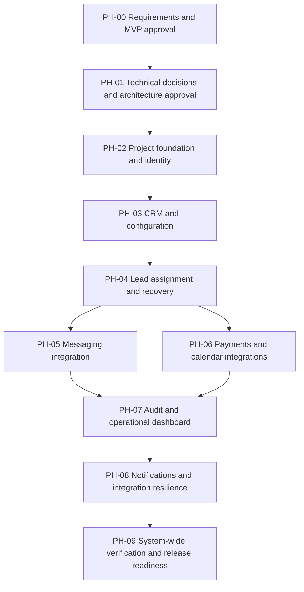

# Implementation Phases and Verification Roadmap
**Status:** Proposed roadmap only — blocked from execution until requirements and MVP scope are approved. Tasks below describe planning, not completed work. No application code has been written or tested by this document.

**Related:** [PRD](PRD.md) · [TRD](TRD.md) · [Architecture](Architecture.md) · [Rules](Rules.md)

## 1. Sequencing principle
First establish and approve a reliable requirements baseline and MVP scope. Only then approve technical choices and architecture. Implementation phases must trace to source requirements and must not include unapproved features.

## 2. Phase overview

**Proposed dependency order only.** Actual sequence may change after the requirements and architecture are approved. The diagram does not authorize development.

## 3. Phases

### PH-00 — Requirements and MVP approval
**Objective:** Resolve blockers and obtain explicit approval for the requirements baseline and MVP scope.  
**State:** Blocking; not complete.

| Task | Action | Traceability | Acceptance / exit criteria |
|---|---|---|---|
| TASK-001 | Resolve OQ-01–OQ-08 covering AI/email handover, accountability, absence fallback, custom-field approval and timer rules. | F3.*, F2.2, stakeholder clarifications | Decisions recorded with impacts; no unresolved blocker in these flows. |
| TASK-002 | Resolve OQ-09 on one vs multiple pipelines. | F2.3, F2.5, scope section | Approved interpretation recorded. |
| TASK-003 | Review full included/excluded scope and propose any deferrals separately. | Sections 3–6, F/I/Q | Every deferral explicitly approved or no deferral made. |
| TASK-004 | Validate requirements traceability and acceptance criteria. | F1–F5, I1–I5, Q1–Q14 | Source IDs preserved; gaps and ambiguity documented. |
| TASK-005 | Obtain explicit stakeholder approval of requirements baseline and MVP. | All | Written explicit approval; otherwise block next phase. |

**Exit gate:** Explicit approval of requirements and MVP scope. No architecture or provider selection before this gate.

### PH-01 — Technical decisions and architecture approval
**Objective:** Select and approve the technical approach after PH-00 passes.  
**State:** Blocked pending PH-00.

| Task | Action | Traceability | Acceptance / exit criteria |
|---|---|---|---|
| TASK-006 | Evaluate stack/database/hosting/session/real-time/timer options against approved requirements. | Q1–Q14, F/I requirements | Comparison and rationale reviewed; choices explicitly approved. |
| TASK-007 | Design component boundaries, trust boundaries, data flows and failure behavior. | Q2–Q6, Q11, Q14, I5 | Architecture diagrams agree with approved flows and requirements. |
| TASK-008 | Finalize logical/physical data model and migrations approach. | F2, F3, F4, F5, I1–I5, Q4–Q6 | Schema reviewed; fields and relations trace to approved needs. |
| TASK-009 | Select exact I4 transactional email provider and document provider constraints. | F3.9, I4, I5 | Provider decision approved; no unapproved vendor assumed. |
| TASK-010 | Define test strategy, environment setup and deployment approach. | Q5–Q13, all integrations | Written, reproducible plan and exit gates approved. |

**Exit gate:** Approved TRD, architecture and data model; unresolved items are explicitly accepted as non-blocking or resolved.

### PH-02 — Project foundation and identity
**Objective:** Build approved project setup, authentication, workspaces and permissions.  
**Requirements:** F1.1–F1.6, Q1–Q3, Q6, Q13, Q14.  
**Prerequisite:** PH-01 approved.

Planned tasks: setup repository structure and configuration; implement workspace signup/session lifecycle; implement Owner/Admin/User and configurable permissions; enforce server-side tenant isolation and field-level opportunity-value protection; establish persistent storage and test setup.

**Exit criteria:** Sign-up creates workspace and Owner; session persists and can end; unauthorized and cross-workspace API tests pass; secrets are externalized; setup instructions and sample data exist.

### PH-03 — CRM and configuration
**Objective:** Implement source-approved CRM records, fields, stages, filters and history.  
**Requirements:** F2.1–F2.8, Q4, Q6–Q10, Q12.  
**Prerequisite:** PH-02 exit criteria pass.

Planned tasks: implement contacts/companies/opportunities and approved relationships; custom field types and field-set behavior; required fields by stage; safe stage operations; dynamic saved lists; activity history and complete contact view.

**Exit criteria:** Acceptance criteria for approved CRM requirements pass; stage deletion blocked until opportunities moved; custom-field approval flow matches the approved decision; data integrity and concurrent-edit tests pass.

### PH-04 — Lead assignment, acknowledgement and recovery
**Objective:** Implement lead intake and accountable human assignment/escalation.  
**Requirements:** F3.1–F3.8, Q4–Q5, Q10–Q11.  
**Prerequisite:** PH-03 as needed for CRM relationships; approved architecture.

Planned tasks: implement source-labelled lead intake; availability and assignment rules; acknowledgement window and timers; escalation chain; absence reassignment; recovery queue; AI conversation trigger and continuing human assignment attempts only according to approved clarification; enforce single ownership.

**Exit criteria:** Race, restart, reassignment, unavailable employee, timeout and recovery-queue tests pass; no unresolved AI ownership/handover rule remains.

### PH-05 — Messaging integration
**Objective:** Connect real Twilio WhatsApp Sandbox or approved SMS alternative.  
**Requirements:** I1.1–I1.9, I5.1–I5.8, F3.1, F2.7–F2.8.  
**Prerequisite:** PH-04 ownership behavior and PH-01 integration design approved.

Planned tasks: configure workspace connection and webhook; verify signatures; ingest and send messages; process delivery callbacks; match known messaging numbers; handle duplicates, failures, retry and opt-out; show conversation ownership/status.

**Exit criteria:** Real sandbox inbound/outbound round-trip verified; forged signature rejected; duplicate events idempotent; failure and opt-out behavior verified.

### PH-06 — Payments and calendar integrations
**Objective:** Connect Stripe test mode and Google Calendar OAuth 2.0.  
**Requirements:** I2.1–I2.8, I3.1–I3.7, I5.1–I5.8, F2.7–F2.8, F5.1.  
**Prerequisite:** PH-01 and approved CRM/record relationships.

Planned tasks: payment request and signed webhook outcomes; refund and revenue handling; employee OAuth connection/token lifecycle; real appointment create/change/cancel; busy-time/conflict behavior; timezone handling and activity history.

**Exit criteria:** Stripe test payment/refund states and duplicate webhook tests pass; Google Calendar event synchronization and revoked-token behavior verified; no card data stored/logged.

### PH-07 — Audit and operational dashboard
**Objective:** Deliver immutable audit history and operational dashboard.  
**Requirements:** F4.1–F4.3, F5.1–F5.5, Q10–Q12.  
**Prerequisite:** Relevant CRM, lead and integration records exist.

Planned tasks: record required events and before/after values where relevant; enforce audit read permission and immutable entries; calculate glossary-defined dashboard figures; implement drill-down and user figure preferences.

**Exit criteria:** Audit filters and immutability tests pass; dashboard metrics reconcile to source records; role-aware figures and at least three drill-downs meet requirements.

### PH-08 — Notification integration and shared resilience
**Objective:** Deliver external escalation email and cross-integration status/resilience.  
**Requirements:** F3.9, I4.1–I4.4, I5.1–I5.8.  
**Prerequisite:** Exact provider approved; escalation behavior implemented.

Planned tasks: configure per-user email destination; send escalation alert with lead/source/reason/link; record failures and bounded retries; expose integration status/sync history/errors; ensure workspace isolation and provider failure isolation.

**Exit criteria:** Real delivery verified within the source's stated same-minute requirement in the test scenario; failure/retry/admin visibility verified; integration permission and audit behavior pass.

### PH-09 — System-wide verification and release readiness
**Objective:** Verify the approved scope end-to-end without expanding it.  
**Requirements:** All approved F/I/Q requirements.  
**Prerequisite:** Previous dependent phases pass.

Tasks: full regression suite; end-to-end business journeys; security and cross-tenant tests; accessibility/responsive review; concurrency/restart/idempotency tests; performance checks using source-defined scenarios; configuration/secrets review; documentation and setup verification; record known limitations and release decision.

**Exit criteria:** All approved acceptance criteria pass or have explicitly accepted exceptions; tests and commands/results are documented; no unapproved requirements or vendor assumptions remain; release readiness explicitly approved.

## 4. Mandatory end-of-phase testing gate
At the end of every implementation phase that changes executable code:
1. Run applicable unit tests.
2. Run integration tests against changed components and real interfaces.
3. Run regression tests for previously working behavior.
4. Verify phase acceptance criteria.
5. Review security, accessibility, performance and error handling.
6. Fix in-scope defects and rerun affected tests.
7. Update documentation and task status.
8. Record commands, outcomes, failures, limitations and remaining issues.

For documentation/decision-only phases, use proportionate review and traceability validation instead of meaningless code tests. Do not begin a dependent phase until its predecessor meets exit criteria. If a test cannot run, document why and the follow-up needed.

## 5. Project-level blockers
- Requirements/MVP baseline not explicitly approved.
- AI conversation and summarized-email handover order/trigger unresolved.
- Email recipient when no previous assignee exists unresolved.
- Email non-response deadline unresolved.
- Same-department reassignment fallback unresolved.
- Custom-field approval lifecycle unresolved.
- Exact I4 provider unresolved.
- One-vs-multiple-pipeline scope ambiguity unresolved.
- Stack, database, hosting, timer and real-time mechanisms not approved.

## 6. Status semantics
`Not started` means planned, not executed. `Blocked` means a required decision or dependency is unresolved. `Verified` may only be used after actual evidence is recorded. No task in this file is marked implemented or verified.
